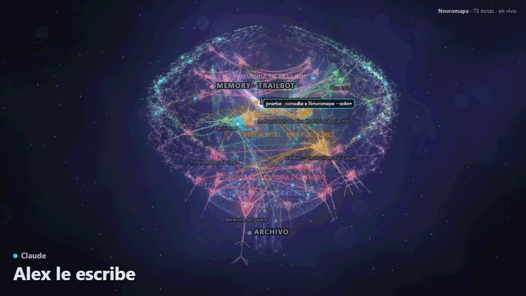

# Neuromapa

[](https://github.com/lumiel777/neuromapa/actions/workflows/pruebas.yml)

**Claude Code's memory as a live 3D brain.** A doctor that warns you when your notes go stale, and a search that
hands Claude what it already knows before it goes looking again.

*[Versión en español](README.md)* · The interface and messages are in Spanish for now. ·
**[Wiki](https://github.com/lumiel777/neuromapa/wiki/English)** (step-by-step guide, in Spanish, with an English summary)



## Get started in a minute

You need [Python](https://www.python.org/downloads/) 3.10 or newer and [git](https://git-scm.com/downloads).

1. Install it:

   ```
   claude plugin marketplace add lumiel777/neuromapa
   claude plugin install neuromapa@neuromapa
   ```

2. Close Claude Code and open it again: the plugin only loads then.
3. In a Claude Code session, type `/neuromapa:abrir`. The map of your notes opens. If you don't have notes yet,
   `/neuromapa:abrir --demo` shows one with sample notes.

On the map, `?` explains what everything is. More in [Install](#install) and in the
[wiki](https://github.com/lumiel777/neuromapa/wiki/English).

## What it does

- **A map of your notes.** It gathers Claude Code's memory (`~/.claude/projects/*/memory/`), your `CLAUDE.md` files and
  any documents you choose, and draws them as a brain: every note is a shape, and every time a note names another,
  a connection.
- **Live.** While Claude works you see which note it reads, which file it edits, which agent it launched, and in which chat.
  At the bottom, the timeline shows the last 10 minutes with one line per chat: everything it did, when you wrote to
  it, the agents it launched, and whether it is waiting for your OK.
- **A doctor.** `/neuromapa:salud` checks the memory: links to notes that no longer exist, notes nobody links to,
  duplicated memories or ones the index doesn't list, and incomplete headers. If you add your projects to `config.json`,
  also `file:line` anchors that drifted, commits that don't exist and notes that say something is broken when a later
  commit seems to have fixed it; and the numbers you record in `hechos.json`, the day they stop being true.
- **A search.** `/neuromapa:sobre topic` says which notes to read first, flags stale facts, gathers the recorded
  decisions on that topic and names the code those notes cite, so Claude checks it before answering. Claude can call
  it whenever it wants; with the automatic context on, it gets it on every request. The map shows why it picked each
  note: the ray takes a color by reason (your words, an index that names it, or what it learned) and the note says it,
  with the lines.
- **It learns from your use.** Like a brain: what is used together gets connected, and what isn't repeated fades (by
  half every 14 days). It notices which files are opened together and whether the notes it recommended were read, and
  uses that to add to the hint the code usually opened with those notes, the note usually read alongside, and what was
  read in the last few hours. On the map, the most used connections grow thicker, with beads of light, and pulses
  travel faster along them (like myelin); what is used together without being linked shows up as an «Aprendida»
  connection. It all changes live: the path a chat walks lights up, new paths grow and forgotten ones fade, and the
  «Lo que aprendió» panel shows what it is linking while Claude works; `neuromapa --aprendido` tells you what it
  learned, `neuromapa --aprendido file` shows what that file is used with, and `neuromapa --olvidar` erases a link
  you don't want (or everything about a file). Each install learns on its own computer, from its own use, and starts out knowing
  something from the chats Claude Code had already saved.
- **Automatic warnings.** When Claude creates a memory similar to an existing one, when two chats edit the same file,
  when it writes a link in a note to a note that doesn't exist, when it leaves an overly long line in the index
  (`MEMORY.md`), and when a new problem shows up in your notes.
- **What it did for you.** The «Lo que hizo por vos» block, top left of the map: over the last 7 days, how many hints
  it gave Claude, how many helped, how many recommended notes Claude read and which problems found by the doctor got
  fixed.
- **Optional:** automatic context, which hands Claude the most useful bits of your notes on every request and, when it
  edits a code file, tells it which note is usually read with it if it hasn't read it yet (turned on in the plugin's
  [options](#options)); a brake that asks before launching agents once a chat's agents have used many tokens in the
  last hour (turned on in `config.json`); and a connector for the Chat mode of the Claude desktop app, where hooks
  don't run: it gives those chats read-only access to your notes and shows them on the map (see
  [how it works](docs/como-funciona.md#conector-para-la-app-de-escritorio-de-claude-opcional), in Spanish). The same
  connector works for Codex, which with a hook also gets the hint on every request (see
  [Codex](docs/como-funciona.md#codex-opcional), in Spanish).

## What was measured

**First measurement:** 450 real Claude Code runs (Opus and Sonnet) on 50 questions about a large project, and 30
blind judges.

- Claude spent **14 to 18 % less** per question (with Opus, cheaper on 40 of the 50).
- Fewer serious mistakes (Opus 19 → 16, Sonnet 20 → 13) and fewer outdated facts stated as current (Opus 7 → 3).
- It got as many right or a few more (Opus 82 → 86 %, Sonnet 58 → 72 %), but that difference is not statistically
  solid yet.

**Second measurement, with this version:** 100 Sonnet runs on the same 50 questions, with and without Neuromapa on
the same night, and another 30 blind judges.

- The answers' score went up **from 6.4 to 7.0** out of 10 (better on 29 questions, worse on 11). This time the
  difference is statistically solid (p = 0.006). Leaving out the 17 questions whose facts changed after the reference
  answers were written, it goes up 0.45 and is no longer solid.
- Correct answers: 72 → 80 %. That alone is not solid yet.
- Serious mistakes: 13 → 10. Cost: 8 % less.

Long conversations were not measured.

## Requirements

- [Claude Code](https://code.claude.com).
- [Python](https://www.python.org/downloads/) 3.10 or newer. Nothing else to install: it only uses Python's standard library.
- [git](https://git-scm.com/downloads), because Claude Code downloads the plugin with git. On Windows it comes with Git
  for Windows, which also makes the hooks faster (without Git Bash they still work, with PowerShell).
- For the map, a browser with WebGL (any modern one).

## Install

```
claude plugin marketplace add lumiel777/neuromapa
claude plugin install neuromapa@neuromapa
```

Or, inside a Claude Code session: `/plugin marketplace add lumiel777/neuromapa`, then `/plugin install neuromapa@neuromapa`.

Then close Claude Code and open it again: the hooks and the `/neuromapa:…` commands only load then. The first time you open Claude Code after installing it, Neuromapa says it is installed and how to open the map.
If Python is missing, it says so when Claude Code starts and does nothing until you install it. If Claude Code
says on install that 2 options are not set («userConfig options not yet set»), that is expected: both have defaults
and you can change them any time (see [Options](#options)).

## Update

```
claude plugin marketplace update neuromapa
claude plugin update neuromapa@neuromapa
```

Then close and reopen Claude Code: the new version only takes effect then. If the map was running, open it with
`/neuromapa:abrir --reiniciar`, because the one still running has the old version. Your configuration and what it
learned stay as they were. To check which version you have, `claude plugin list` shows it next to neuromapa; the
[CHANGELOG](CHANGELOG.md) says what each version changed.

## Use

| What | How |
|---|---|
| Open the live map | `/neuromapa:abrir` |
| What is known about a topic | `/neuromapa:sobre weather forecast` |
| Check the memory | `/neuromapa:salud` |
| Check that the install works | Ask Claude to run `neuromapa chequeo`: it says what is missing in plain words |
| Try it with made-up notes | `/neuromapa:abrir --demo` (see [demo/LEEME.md](demo/LEEME.md), in Spanish) |

While the plugin is enabled, Claude also has the `neuromapa` command in its shell (`neuromapa --help` lists
the options) and can use it when it needs to. That command is not in your own terminal; there, use
[Without installing the plugin](#without-installing-the-plugin).

The map turns itself off 10 minutes after its last tab is closed; opening it again while it runs reuses it
(`--reiniciar` starts a fresh one). On the
map, `?` shows help and shortcuts. `A` switches to generic names (anonymous mode) and `C` leaves only the brain
(cinema mode); to show it without revealing your notes, use both, because cinema mode alone does not hide the names.

## Options

In `/plugin configure neuromapa@neuromapa` (or in `/config`):

- **Automatic context on every request** (`servir_contexto`), off by default. When on, it also reminds Claude of the
  note usually read with each code file it edits, and to write down what was decided when the chat is compacted or
  after it changed several files without noting anything (so it isn't lost at the next compaction). Even when off, once per chat it tells Claude about new problems in
  your notes (broken paths or links, memories missing from the index, possible duplicates).
- **Data folder** (`carpeta_datos`): where it keeps its configuration, the live log and the page. Left empty, it uses
  the plugin's own folder (`~/.claude/plugins/data/neuromapa-neuromapa/`), which is deleted when you uninstall. If you
  pick another one, keep it yours alone (see [Privacy](#privacy)).

With no configuration, Neuromapa reads Claude Code's memory and your `CLAUDE.md` files from `~/.claude`. To add
projects, documents, lobes or the agent brake, write a `config.json` in the data folder; [demo/config.json](demo/config.json)
is an example, and [docs/como-funciona.md](docs/como-funciona.md) explains every field (in Spanish).

## Uninstall

```
claude plugin uninstall neuromapa@neuromapa
claude plugin marketplace remove neuromapa
```

Its data folder is deleted, unless you chose your own in `carpeta_datos` or uninstall with `--keep-data`. Your notes
are untouched: Neuromapa never
writes to the memory on its own. When it finds a problem it tells Claude, and it's Claude who may fix it.

## Privacy

- **Nothing leaves your computer.** No telemetry, no server of ours. The map's server only listens on `127.0.0.1` and
  asks for a key. The two libraries the page uses (d3 and marked) ship inside, in `vendor/`, so the map works offline.
  Only if those files were missing or didn't match their hash would the page fetch them from `cdn.jsdelivr.net`, with
  a hash (SRI) the browser checks before using them.
- **What runs on your PC:** Claude Code's hooks run the `hook_*.py` files with your Python. The doctor reads your
  projects' history with `git`, read-only; the history keeps your notes' versions with `git`, in its own repository
  inside the data folder. `/neuromapa:abrir` starts the map's server and opens your browser. The search index and the
  problem list are rebuilt in the background with the same Python. Sleeping with Claude, if you turn it on, runs your
  `claude`. `herramientas/bajar_librerias.py` downloads d3 and marked from `cdn.jsdelivr.net`, but it is for whoever
  maintains the project: no hook runs it. The code in `demo/` belongs to made-up projects and is never run. If you add
  the connector to the desktop app or to Codex, they run `conector_mcp.py` with your Python, and Codex also runs
  `hook_servir.py` if you add the hook.
- **It only changes a note if you approve it:** the nightly pass proposes fixes and `--aplicar` changes only the ones
  you pick. `--partir` (move the old part of a long note into another note) and `--renombrar` (rename a note and
  whatever names it in the memory) first show the plan and only do it with that plan's code (`--confirmar`); before
  that they copy the notes as they were to `respaldos/`, inside the data folder. Other than that, Neuromapa doesn't
  write to your notes. The one exception is something you turn on: with `partir_sola` in `config.json`, the daily pass
  splits a memory that is about to fill up by itself: it moves its oldest entries into a history note or, if it has no
  dates, its second half into a "part 2" note. It does so with the same backup and without losing a line, logs it in
  `respaldos/partidas.log` and tells Claude about it. The same switch also looks after the index: if a note has its
  history notes on separate lines of `MEMORY.md`, it joins them into one line, without changing what each one says or
  losing a link, with the same backup and the same notice. If the note or the index was being edited, it tries again
  half an hour later with a background process of the same Python (see [how it works](docs/como-funciona.md), in
  Spanish). It is off by default.
- **Rules and skills, only if you confirm them:** `--reglas` and `--recetas` suggest turning a memory into a
  path-scoped rule or a recipe into a skill, and are read-only. `--regla` and `--receta` show the text and, only with
  that text's code (`--confirmar`), write one file outside the memory: in the project's `.claude/rules/` or
  `.claude/skills/` (or in your personal skills folder, if the note belongs to no project). That file copies text from
  your memory into the project folder: if the project is pushed to a repository and `.claude/` is not ignored, it
  travels with it. They never overwrite a file they didn't write.
- **Sleeping with Claude, only if you turn it on** (`dormir_con_claude` in `config.json`): the daily pass sends Claude,
  through your own Claude Code, lines from your notes and the changes of some commits (never those of sensitive files),
  just like any chat, and spends from your account up to the daily cap you set.
- **To count tokens and errors**, `--salud`, the brake and the lessons read the chats Claude Code keeps in
  `~/.claude/projects`. They don't copy them or send them anywhere. Learning also reads them once, to start out
  knowing something: from each one it only takes which files were read or edited together, never what they say.
- **`--charlas` searches those chats only when you ask**: it reads what you wrote and what Claude answered (never what
  the tools returned, the commands, or Claude's internal thinking), keeps no copy or index, and masks anything that
  looks like a key before showing it. Claude Code deletes terminal chats after 30 days (`cleanupPeriodDays`); it keeps
  desktop app chats forever.
- **The live log keeps paths, tool types and counts**, never the text of your messages, the commands Claude runs, what
  it searches for, or full web addresses. When Claude Code loads a path-scoped rule, it notes which rule it was (its
  path), so `--reglas` can count how much it is used: never its text or the file that made it load. Anything older
  than 90 days is deleted on its own (a per-day summary stays); change it with `borrar_registros_dias` in
  `config.json`, where 0 means never.
- **What it learns is paths and numbers** (`en-vivo/aprendido.json`, drawn from that log): which files were used
  together and which recommended notes were read. Turn it off with `"aprender": false` in `config.json`.
- **The page (`cerebro.html`) contains the text of your notes**, even in anonymous mode: don't share it. To show the
  map, share a screenshot or a video made in anonymous mode, or the copy from the **Sin notas** button (same neurons and
  connections, generic names, no text or paths).
- **The history (`historial/` in the data folder) keeps every version of your memory notes**, so nothing that gets
  deleted is lost. It stays on your PC, starts closed to your account and, like the page, is not to be shared. It skips
  files that look sensitive by name (`.env`, `id_rsa`, `.ssh/`…) and hidden folders. Whatever goes in stays in the old
  versions: if you ever wrote down something that shouldn't be there, delete the `historial/` folder and it starts over
  from there. `--sobre` and `--buscar` with `--al DATE` answer with the memory as it was that day: to do so they copy
  that version to your account's temp folder and delete it when done. `--cambios` and the “cambió el…” notice in
  `--sobre` only read that history to compare versions: they store nothing.
- Whatever Claude reads from Neuromapa goes to Anthropic, like any file Claude opens. If you connect it to Codex,
  whatever Codex reads (and the hint on every request, if you add the hook) goes to OpenAI; anything shaped like a
  key comes out masked.
- **The data folder must be yours alone**, not a shared folder or the root of a drive other accounts on the PC use:
  whoever can write there can change what Neuromapa passes to Claude. The folders Neuromapa creates start closed to your
  account, and `/neuromapa:salud` warns (with the command to close it) if another account can write to the data folder
  or the program's folder.

## Without installing the plugin

```
git clone https://github.com/lumiel777/neuromapa neuromapa
cd neuromapa
sh bin/neuromapa abrir --demo
```

On Windows, from PowerShell or `cmd`: `bin\neuromapa.cmd abrir --demo`. Each launcher finds a Python 3.10 or newer on
its own: `bin/neuromapa` tries `python3`, `python` and `py`, and `bin\neuromapa.cmd` tries `py -3` and `python`.
`sh bin/neuromapa --help` (or `bin\neuromapa.cmd --help`) lists everything the terminal tool does, and
`python3 herramientas/prueba_humo.py` (on Windows, `py -3 herramientas/prueba_humo.py`) runs the tests without
touching anything of yours.

Without the plugin there are no hooks: the map shows your notes, but not what the chats are doing live, it doesn't
learn from that, and Claude gets neither the warnings nor the automatic context. For that, install the plugin.

## Status

Version 0.1, being tested. Tested on Windows and Linux; not yet on Mac. The [wiki](https://github.com/lumiel777/neuromapa/wiki)
has a step-by-step guide, FAQ and troubleshooting (in Spanish, with an
[English summary](https://github.com/lumiel777/neuromapa/wiki/English)). If you were invited to test it, follow
[docs/probar.md](docs/probar.md) (in Spanish). If you use Obsidian, [docs/obsidian.md](docs/obsidian.md) explains how
to use both on the same folder (in Spanish). If something breaks, open an issue; for security problems, see
[SECURITY.md](SECURITY.md). To contribute, see [CONTRIBUTING.md](CONTRIBUTING.md) (in Spanish); changes per version
are in [CHANGELOG.md](CHANGELOG.md) (in Spanish).

## License

[MIT](LICENSE). It ships, unchanged, the d3 modules the page uses (ISC; `d3-ease`, BSD) and marked (MIT): see
[vendor/LICENCIAS.md](vendor/LICENCIAS.md).
